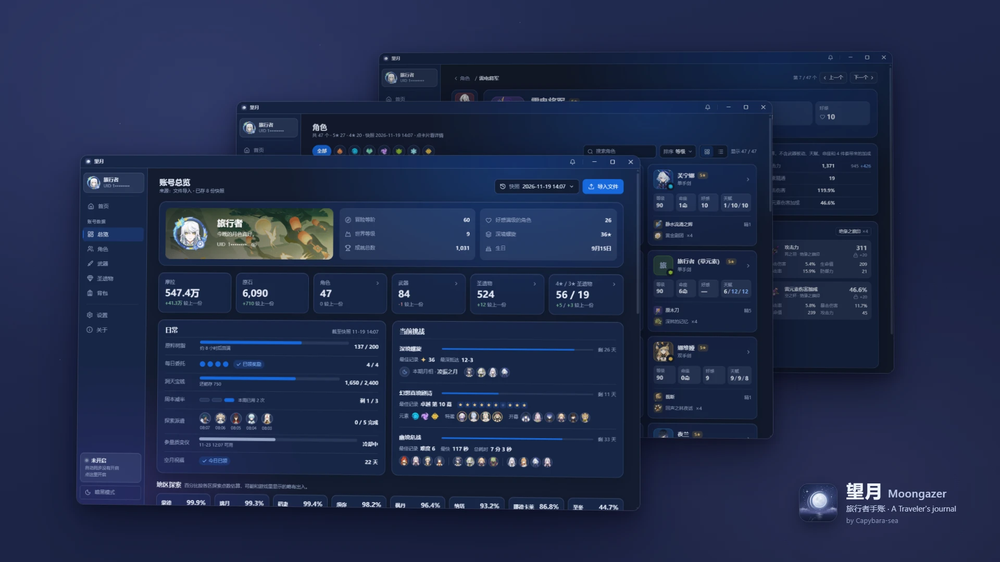

<div align="center">

**简体中文** · [English](README.en.md)


# 望月（Moongazer）

星海广阔无垠，我们并不孤单。

在电脑上查看原神账号的角色、武器、圣遗物、背包与成就，并计算养成所需的材料。

### [下载最新版](https://github.com/Capybara-sea/moongazer/releases/latest)

Windows 10/11（64 位）· 免费 · 简体中文 / English 界面 · 早期开发中

</div>



<sub>截图为测试数据。</sub>

## 功能

- **总览**：每日任务（原粹树脂、每日委托、洞天宝钱等）、深境螺旋等挑战的进度、摩拉与原石的变化趋势，以及每次登录后的变化。
- **角色、武器、圣遗物、背包**：自动同步，支持筛选。
- **收集**：成就、游逸旅闻、摆设套装与旋曜玉帛。
- **祈愿**：按卡池查看祈愿记录、保底和往期卡池，导入导出 UIGF 文件，估算现有资源能抽到什么。
- **规划**：为角色和武器设定培养目标，计算所缺材料及需先合成的材料。
- **提醒**：原粹树脂回满、探索派遣完成、委托奖励未领取、深境螺旋即将重置等；望月在后台运行时也会发送 Windows 通知。
- **多账号**：登录游戏时自动切换。
- 计划中：圣遗物优化、尘歌壶套装奖励图鉴。

## 使用前须知

- 需要 64 位 Windows 10 或 11，且原神电脑版须在同一台电脑上运行。手机、云原神和主机平台无法同步。自动同步目前仅在国服电脑版上测试过。
- 无需登录米游社或其他账号。账号数据仅保存在本机，望月仅在检查更新、下载游戏图标，以及开启“自动读取祈愿记录”后读取祈愿记录时联网。
- 自动同步需要管理员权限，每次开启时 Windows 均会请求确认。自动同步仅读取原神的网络数据，不向游戏发送任何数据，也不修改游戏文件。望月为非官方工具，使用风险由用户自行承担。

## 下载与安装

1. 打开[下载页](https://github.com/Capybara-sea/moongazer/releases/latest)（无需注册 GitHub 账号）。请勿点击仓库首页绿色的 **Code** 按钮，该按钮下载的是源代码，无法直接运行。
2. 在下载页向下滚动至 **Assets**，下载以下两个版本之一。两个版本功能相同，不确定时请选择安装版。

   | 对比项   | 安装版（推荐）                            | 便携版                                   |
   | -------- | ----------------------------------------- | ---------------------------------------- |
   | 下载文件 | 文件名以 `setup.exe` 结尾                 | 文件名以 `portable.zip` 结尾             |
   | 使用方式 | 运行安装程序，无需管理员权限              | 解压后运行其中的 `Moongazer.exe`         |
   | 数据位置 | 当前用户的 AppData 文件夹，可在设置中更改 | 程序所在文件夹中的 `app-data`            |
   | 更新方式 | 自动更新                                  | 自动更新（所在文件夹需可写入）           |
   | 卸载方式 | 在 Windows 设置的“应用”中卸载             | 删除整个文件夹，数据一并删除             |
   | 适用场景 | 大多数用户                                | 不希望安装，或需放在其他磁盘、U 盘中使用 |

   Assets 中的其他文件（`.sig`、`latest.json`、`SHA256SUMS.txt`、`THIRD_PARTY_NOTICES.txt`、Source code）均无需下载。如下载页无法打开或下载缓慢，请稍后重试。
3. 下载和运行时可能出现以下提示，原因均为望月没有数字签名：
   - 浏览器提示此文件不常被下载：在下载列表中选择“保留”（Edge 会再次询问，请点击“显示更多”→“仍然保留”）。
   - 运行 setup.exe 或解压后的 `Moongazer.exe` 时，Windows 显示蓝色的“Windows 已保护你的电脑”：确认文件来自上述下载页后，点击“更多信息”→“仍要运行”。

   开启了“智能应用控制”的 Windows 11 会直接阻止运行，且不提供“仍要运行”选项，此时无法使用望月。可在开始菜单中搜索“智能应用控制”查看是否已开启。
4. 安装版：运行 setup.exe，选择简体中文，按“下一步”完成安装。安装后开始菜单中的名称为 **Moongazer**。\
   便携版：右键单击 zip 文件，选择“全部解压缩”，然后运行解压出的 `Moongazer` 文件夹中的 `Moongazer.exe`。请勿删除同一文件夹中的 `portable` 文件（它使数据保存在程序所在文件夹中），也不要将其放在 `C:\Program Files` 等需要管理员权限才能写入的文件夹中。

## 首次使用

望月按 Windows 的显示语言显示简体中文或英文，可在“设置 › 界面 › 语言”中切换。

1. 打开望月，在首页点击“开始同步”。
2. Windows 将询问“你要允许来自未知发布者的此应用对你的设备进行更改吗？”，请点击“是”。读取网络数据需要管理员权限，仅由望月单独启动的“同步助手”使用。该窗口显示为黄色，同样是因为没有数字签名。每次开启同步时都会询问。
3. 启动原神并进入提瓦特，望月将自动读取账号数据，并实时记录游戏中的变化。\
   如开启同步时已在游戏中，请返回标题界面重新进入。
4. 之后每次游戏前，请打开望月并开启同步：点击左下角的“自动同步未开启”，再点击“开启自动同步”。首次开启同步后，望月会询问是否在打开望月时自动开启；选择“自动开启”后无需每次手动开启，之后也可在设置中更改。

关闭窗口不会退出望月，程序将保留在任务栏右下角的托盘中（如未显示，请点击该处的 ^ 箭头），提醒和同步均需望月保持运行。如需退出，请右键单击托盘图标，选择“退出望月”。望月不会开机自动启动。

如不使用自动同步，也可在“总览”中点击“导入文件”，选择 [Teyvat.me Capture](https://github.com/tawan475/teyvat.me-capture) 导出的 Leyline 文件（.json）。未使用过 Teyvat.me Capture 的用户可忽略此项。

## 更新

望月会自动检查新版本并在后台下载，出现“重启更新”时点击即可完成更新。也可在“关于”页点击“检查更新”。游戏版本更新后，如望月提示需要更新，请先更新望月。

自动更新失败时，可手动更新：安装版运行新版 setup.exe，出现“已安装”页面时选择“请勿卸载”；便携版需先退出望月，再用新 zip 中的 `Moongazer.exe` 替换旧文件，保留 `app-data` 文件夹。两种方式均不会丢失数据。

## 卸载

- 安装版：先右键单击托盘图标并选择“退出望月”，再在 Windows 设置的“应用”中找到 **Moongazer** 并卸载。卸载时可选择“删除应用程序数据”，该选项默认不勾选，不勾选时账号数据将保留。
- 便携版：退出望月后删除整个文件夹即可，数据将一并删除。

## 常见问题

<details>
<summary>数据存储在哪里？如何备份或迁移到新电脑？</summary>

在望月的“设置 → 数据”中点击“打开文件夹”。退出望月后复制整个文件夹即可完成备份。迁移到新电脑时，先在新电脑上安装望月，以同样方式打开数据文件夹，退出望月后用备份替换该文件夹。安装版也可在此处更改数据位置。

</details>

<details>
<summary>部分卡片没有数据？</summary>

自动同步只能读取游戏发送的数据。例如幽境危战的记录，需在游戏中打开危战菜单后才能读取。

</details>

<details>
<summary>杀毒软件提示或拦截？</summary>

望月没有数字签名，且同步助手需以管理员权限读取网络数据，部分杀毒软件可能因此发出提示。是否放行请自行判断，也可先按下一条的方法校验文件。

</details>

<details>
<summary>如何确认下载的文件未被修改？（进阶，可跳过）</summary>

在文件所在文件夹的空白处按住 Shift 并右键单击，选择“在终端中打开”（或“在此处打开 PowerShell 窗口”），然后运行：

```powershell
Get-FileHash .\Moongazer*
```

将显示的 Hash 与下载页上该文件旁以 sha256: 开头的值（可点击旁边的按钮复制）进行对照，两者一致（不区分大小写）即为发布时的原始文件。如已安装并登录 [GitHub CLI](https://cli.github.com)，还可运行 `gh attestation verify 文件名 --repo Capybara-sea/moongazer`，确认文件由本仓库的 GitHub Actions 构建。

</details>

## 交流与反馈

如遇问题或有建议，欢迎加入 QQ 群 90376195（[点击加入](https://qm.qq.com/q/knbjLmXja0)）。也可使用 GitHub 账号在 [Issues](https://github.com/Capybara-sea/moongazer/issues) 中反馈。

## 从源码构建（面向开发者）

需要：Windows 10/11 x64、Rust stable（1.100 以上）、Node.js 24、pnpm（会自动用 `package.json` 里写的版本）、cargo-deny 和 7-Zip（在 PATH 上或装在默认位置）。

```sh
pnpm install --frozen-lockfile   # 同时装好 Git 钩子
cargo xtask gen-data             # 生成前端要用的游戏数据和界面字体（不在 git 里）
cargo xtask check                # CI 跑的全部检查
pnpm --filter @moongazer/desktop tauri dev
```

## 致谢

- [Teyvat.me Capture](https://github.com/tawan475/teyvat.me-capture)：Leyline 格式，以及自动同步背后的解码。
- [DimbreathBot/AnimeGameData](https://github.com/DimbreathBot/AnimeGameData)：游戏数据。
- [Snap.Metadata](https://github.com/SnapHutaoRemasteringProject/Snap.Metadata)：游戏数据。
- [Genshin Optimizer](https://github.com/frzyc/genshin-optimizer)：GOOD 格式，Leyline 在它的基础上扩展。生成数据时用它核对物品键名，程序里不带它的数据。
- [Enka.Network](https://enka.network) 和 [Project Amber](https://gi.yatta.moe)：游戏图标。
- [更纱黑体 Sarasa Gothic](https://github.com/be5invis/Sarasa-Gothic)：界面字体，SIL Open Font License 1.1 许可。
- B 站 UP 主栖霆杨的[「原神游逸旅闻」](https://www.bilibili.com/toy/genshin-travelers-tales)：游逸旅闻的地点和前置、隐藏逸闻的触发方式，经作者同意参考。

## 许可证

代码以 [MIT](LICENSE) 许可证发布。logo 和应用图标不在 MIT 范围内，保留所有权利。这包括 `assets/logo/`、由它生成的 `apps/desktop/src-tauri/icons/`，以及程序里显示的 logo。fork 如果要发布程序，得换成自己的 logo 和图标。

本仓库改编了一些第三方代码，发布的程序里带有界面字体（SIL Open Font License 1.1 许可，不在 MIT 范围内）、游戏密钥和游戏数据，它们的来源和许可见 [THIRD_PARTY_NOTICES.md](THIRD_PARTY_NOTICES.md)。程序里带的第三方组件，完整清单在程序的“关于”页里。游戏密钥和游戏数据不在 MIT 范围内。

## 声明

望月是非官方的爱好者工具，与米哈游、COGNOSPHERE PTE. LTD.（HoYoverse）均无关联，也没有得到它们的认可或赞助。《原神》以及游戏里的名称、图片和数据，商标和著作权归米哈游和 COGNOSPHERE PTE. LTD. 所有。本仓库不含游戏图片、字体或游戏数据表；发布的程序里有取自游戏数据的文字和数值。
