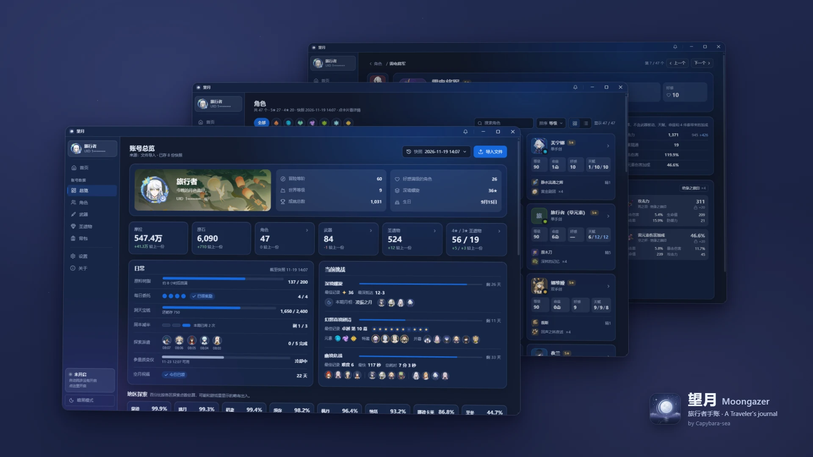

# 望月（Moongazer）

[English](README.md) · **简体中文**

星海广阔无垠，我们并不孤单。

旅行者手账，一款 Windows 桌面应用，目前处于早期开发阶段。界面暂时只有简体中文，以后会支持更多语言。



<sub>截图为测试数据。</sub>

## 功能

- 账号总览可查看日常、深渊、摩拉原石走势。
- 自动同步角色、武器、圣遗物、背包信息，方便查看。
- 支持多账号管理。
- 支持导入 Leyline 文件（JSON 格式的账号导出）。
- 养成规划：算出练角色和武器还差多少材料（TODO）
- 圣遗物优化（TODO）
- 游逸旅闻图鉴（TODO）
- 成就图鉴（TODO）
- 尘歌壶套装奖励图鉴（TODO）
- 提醒：原粹树脂回满、探索派遣完成、每日委托没领奖励、深境螺旋快重置等（TODO）
- 多语言（TODO）

自动同步只接收数据：从不向游戏发送任何东西，不修改游戏文件。使用的风险自行承担。

## 下载

在 [Releases](https://github.com/Capybara-sea/moongazer/releases) 下载：

- `Moongazer_<版本>_x64-setup.exe`：安装版。
- `Moongazer_<版本>_x64-portable.zip`：便携版。

## 使用说明

第一次运行时 Windows 可能弹出“Windows 已保护你的电脑”。文件是从本仓库的 Releases 下载的，就点“更多信息”，再点“仍要运行”。开着“智能应用控制”的 Windows 11 会直接拦下，没有这个选项。

想先核对文件，可以在 PowerShell 里运行 `Get-FileHash <文件>`，和同一版本发布页里的 `SHA256SUMS.txt` 对照；装了 GitHub CLI 的话，也可以运行 `gh attestation verify <文件> --repo Capybara-sea/moongazer`。

安装版不需要管理员权限，默认装在 `%LOCALAPPDATA%\Moongazer`，安装时可以改。数据默认放在 `%LOCALAPPDATA%\io.github.capybara-sea.moongazer`，可以在设置里改。

开启自动同步时会弹 UAC 提示，提示是黄色的、发布者显示为未知，因为程序没有签名。不开自动同步就不会弹。

## 交流

QQ 群 90376195，[点击加入](https://qm.qq.com/q/knbjLmXja0)。

## 开发

需要：Windows 10/11 x64、Rust stable（1.100 以上）、Node.js 24、pnpm（会自动用 `package.json` 里写的版本）和 cargo-deny。

```sh
pnpm install --frozen-lockfile   # 同时装好 Git 钩子
cargo xtask gen-data             # 生成前端要用的游戏数据（不在 git 里）
cargo xtask check                # CI 跑的全部检查
pnpm --filter @moongazer/desktop tauri dev
```

## 致谢

- [Teyvat.me Capture](https://github.com/tawan475/teyvat.me-capture)：Leyline 格式，以及自动同步背后的解码。
- [DimbreathBot/AnimeGameData](https://github.com/DimbreathBot/AnimeGameData)：游戏数据。
- [Snap.Metadata](https://github.com/SnapHutaoRemasteringProject/Snap.Metadata)：游戏数据。
- [Genshin Optimizer](https://github.com/frzyc/genshin-optimizer)：GOOD 格式，Leyline 在它的基础上扩展。生成数据时用它核对物品键名，程序里不带它的数据。
- [Enka.Network](https://enka.network) 和 [Project Amber](https://gi.yatta.moe)：游戏图标。
- B 站 UP 主栖霆杨的[「原神游逸旅闻」](https://www.bilibili.com/toy/genshin-travelers-tales)：游逸旅闻的地点和前置、隐藏逸闻的触发方式，经作者同意参考。
## 许可证

代码以 [MIT](LICENSE) 许可证发布。logo 和应用图标不在 MIT 范围内，保留所有权利。这包括 `assets/logo/`、由它生成的 `apps/desktop/src-tauri/icons/`，以及程序里显示的 logo。fork 如果要发布程序，得换成自己的 logo 和图标。

本仓库改编了一些第三方代码，发布的程序里也带有游戏密钥和游戏数据，它们的来源和许可见 [THIRD_PARTY_NOTICES.md](THIRD_PARTY_NOTICES.md)。程序里带的第三方组件，完整清单在程序的“关于”页里。游戏密钥和游戏数据不在 MIT 范围内。

## 声明

望月是非官方的爱好者工具，与米哈游、COGNOSPHERE PTE. LTD.（HoYoverse）均无关联，也没有得到它们的认可或赞助。《原神》以及游戏里的名称、图片和数据，商标和著作权归米哈游和 COGNOSPHERE PTE. LTD. 所有。本仓库不含游戏图片、字体或游戏数据表；发布的程序里有取自游戏数据的文字和数值。
